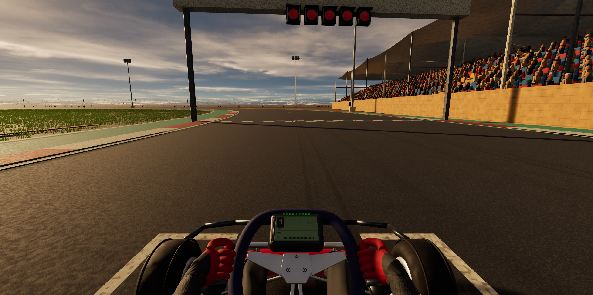

# Game development process - I improved the gloved hands holding the steering wheel

**Date:** October 28, 2026

**Developer:** Me, the human project owner

**Assistance:** Codex assisted with hand geometry, rig fitting, exports, Unreal validation, and this report.

## What I improved

I used my reference images to improve the hand structure while preserving the existing steering wheel. I changed the finger wrap to start outside the rim and curl into the wheel opening, gave the palms fuller tapered volume, spaced the fingers, and repositioned the thumbs to oppose the grip. I updated both cockpit and external driver variants.

I also retained the corrected exported normals so the folded bind-pose geometry would not create black lighting cracks across the posed gloves. The wrists and fingers continue to follow the wheel's real steering motion through the existing baked poses and arm solving.

## How I checked it

The recorded Unreal Play run passed the A-L functional checks across **1,167 samples**. Maximum measured wrist/distal-finger joint drift relative to the wheel was approximately **0.162 mm**. Center, both locks and cockpit views were inspected. All 18 static kart mesh package hashes matched the pre-revision backup, including the original steering wheel.

Joint tracking measures attachment accuracy; it does not certify every glove/rim surface contact. The [results](../../Evidence/PlayerVehicle_v4/Hands/RESULTS.md) and [runtime measurements](../../Evidence/PlayerVehicle_v4/Hands/validation.json) retain those limits.

## Files and remaining limitations

The [editable export variant](../../Art/PlayerVehicle_v4/Hands/PlayerVehicle_v4_ExportNormals.blend) and [rebuild/rollback instructions](../../Art/PlayerVehicle_v4/Hands/README.md) preserve the work. The gloves remain stylized game geometry; inherited suit and cuff seams still need artistic refinement.
