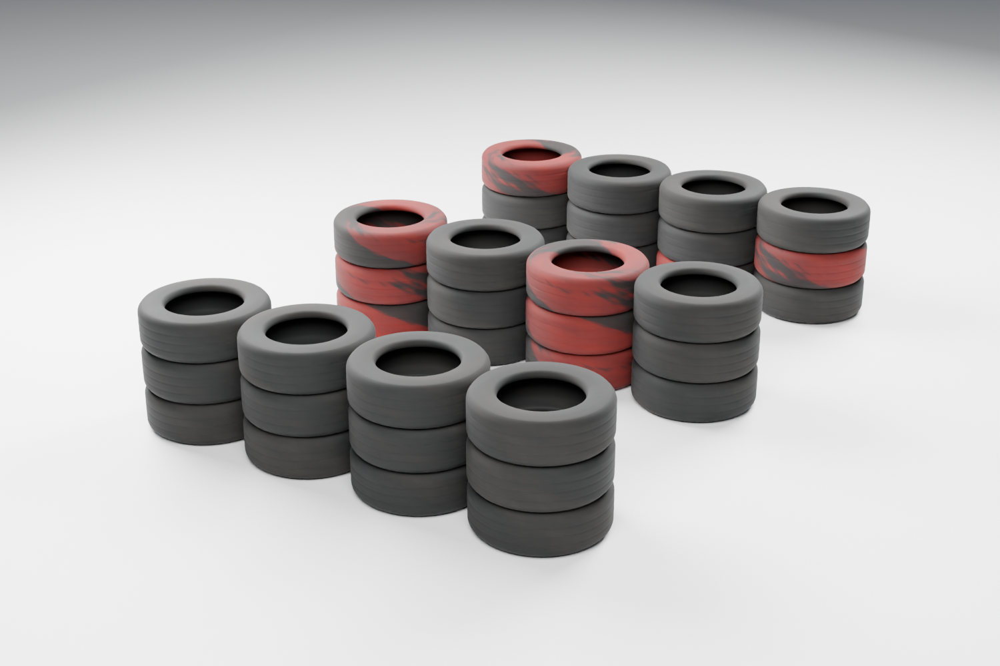

# Game development process - I added realistic-profile stacked tire barriers

**Date:** October 28, 2026

**Developer:** Me, the human project owner

**Assistance:** Codex assisted with Blender automation, materials, Unreal import and placement, validation, and this report.

## What I added

I replaced the simple torus concept with a new approximately **55 cm hollow tire** featuring a flatter tread band, rounded shoulders, inner beads, molded sidewall rings and circumferential grooves. I preserved the original Blender file and its backup.

I created black, alternating red/black and weathered mixed modules. Each approximately **2.19 m** section contains four adjacent columns of three individual tires. I generated portable base-color, roughness and normal textures alongside Blender's connected procedural detail nodes, then imported equivalent Unreal materials, four LODs and simplified convex collision.

## How I checked and placed it

The Blender source was reopened, the tire mesh checked for manifold geometry, and an FBX round trip verified individual objects, UVs, dimensions and axes. Close-up and modular renders were inspected.

The initial Unreal integration placed **144 instanced tires at two outside corners**. All 48 columns were fitted to traced ground. Before/after sweeps covered 748 route segments using a 60 cm sphere radius without adding a kart-corridor obstruction. A direct barrier trace confirmed blocking collision, and additional probes found no existing-structure overlap. A real ProofPawn driver-eye image was captured. Later barrier-expansion work may change the current placement; these numbers describe this initial validated revision.

## Files and remaining limitations

- [Editable Blender source](../../Art/Trackside/TireBarriers/TireBarriers.blend)
- [FBX exports](../../Art/Trackside/TireBarriers/Exports)
- [Unreal driver-eye capture](../../Evidence/TireBarriers/driver_eye_corner.png)
- [Results and limitations](../../Evidence/TireBarriers/RESULTS.md)
- [Generation and rollback instructions](../../Art/Trackside/TireBarriers/README.md)

These are static rigid barriers with simplified collision, including filled center holes for vehicle collision. They do not simulate impact absorption or tire deformation. No full-race performance benchmark or complete driven lap was certified by this pass.
