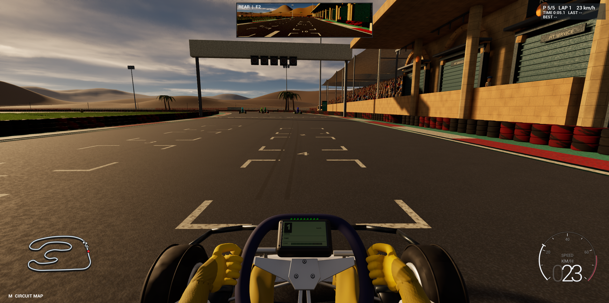

# Game development process - I added a live kart speed gauge

**Date:** October 30, 2026

**Developer:** Me, the human project owner

**Assistance:** Codex assisted with native HUD implementation, compiling, Play-mode testing, and this report.

## What I added

I added a bottom-right speed gauge inspired by my reference image: a transparent curved bar, tick marks, a red upper-range accent, muted leading zeroes and a large digital readout. It scales with the viewport and hides while the full circuit map is open.

I connected it to `AProofPawn::GetVelocity()`, which uses the authoritative tire-dynamics velocity when enabled. The display converts planar cm/s to km/h, supports mph through a presentation-only setting, and identifies reverse using actual movement direction. The arc represents speed rather than engine RPM, and I did not invent a gearbox for the direct-drive kart.

## How I checked it

The native Editor build succeeded. Actual Play checks covered stationary display, acceleration, mph conversion, reverse movement, braking and full-map suppression. **80 rendered log samples** passed conversion and bar-fraction checks. Final screenshots were inspected after correcting the capture timing and an end-label overlap. Map hashes were unchanged by this HUD task.

## Files and remaining limitations

The implementation is [KartSpeedGauge.h](../../Source/Road_To_F1_New/KartSpeedGauge.h), called by the existing [RaceStartGantry.cpp HUD](../../Source/Road_To_F1_New/RaceStartGantry.cpp). The [runtime result](../../Evidence/SpeedGauge/validation.json) and [settings/rollback notes](../../Evidence/SpeedGauge/README.md) preserve the evidence.

The default face range is 80 km/h and affects only the display, not kart performance. The gauge does not claim engine RPM, wheel-spin measurement, or simulated gear changes. Its tests do not certify unrelated gameplay or every possible screen layout.
